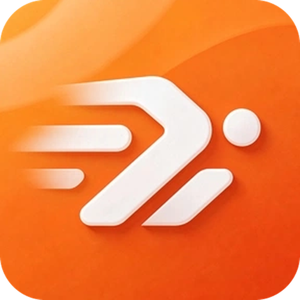
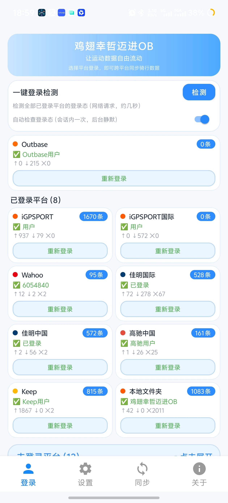
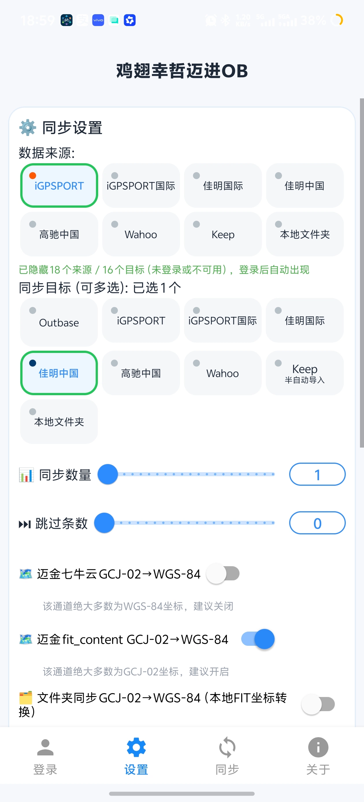
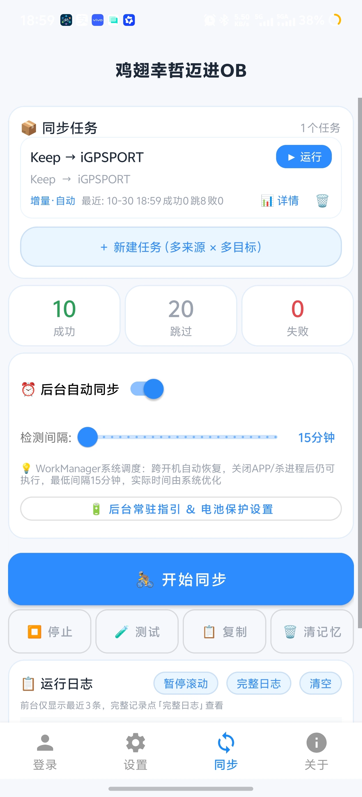
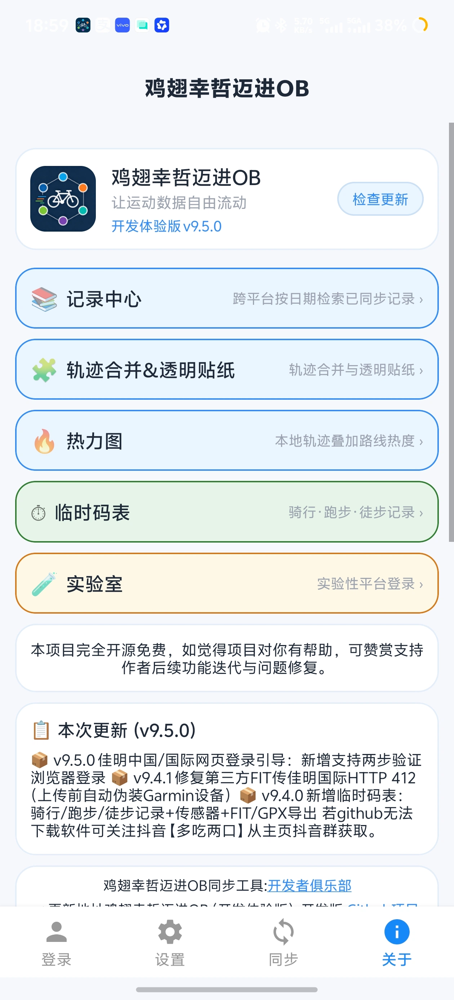
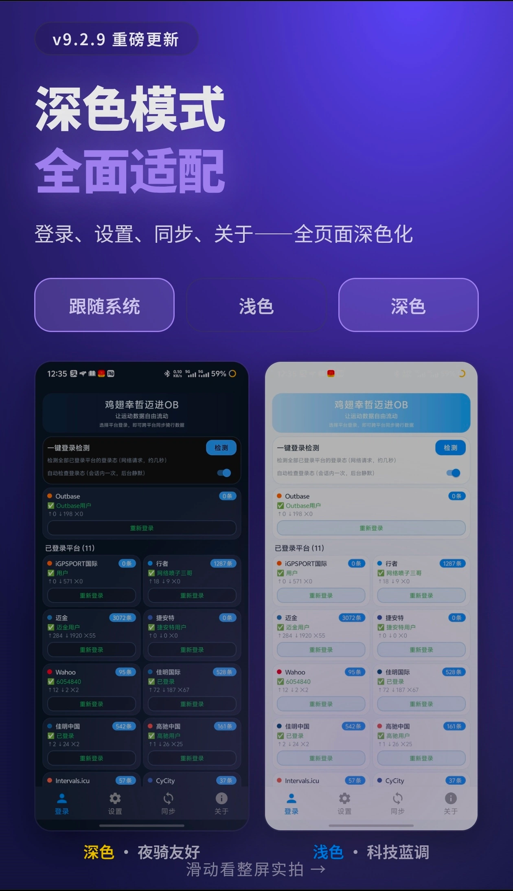

English | [中文](README.md)

# 🚴 JiChi XingZhe MaiJin OB (Dev Experience Edition)

<p align="center"></p>

**Let your workout data flow freely — a workout-data transfer tool for 21 platforms**

[](https://developer.android.com)
[](https://kotlinlang.org)
[](LICENSE)
[]()
[]()

An Android workout-data migration tool that syncs workout records (FIT/GPX) across **iGPSPORT (China / International) / Xingzhe / Magene / Blackbird / Giant / Outbase / Intervals.icu / Garmin International / Garmin China / COROS China / Strava / Wahoo / MyWhoosh / Zwift / Keep / Codoon / Zepp / Komoot / Suunto / Bryton / CyCity** — twenty-one platforms in total. It supports transfers between China and international regions (Bryton now supports download; MyWhoosh, Zwift, Codoon and Zepp are download-only data sources; Intervals.icu supports workout-plan download and pushing to iGPSPORT/Bryton; Keep supports download as a data source plus semi-automatic guided import for upload; Strava is upload-only).

> 📋 The version changelog has moved to the end of this document: [📋 Changelog](#changelog)

> ⚠️ **This dev edition is for testing and trial use only.** Some platform features are limited — see "Known Issues and Limitations" below.

---

## 📱 App Info

| Item | Details |
|------|---------|
| App name | JiChi XingZhe MaiJin OB (Dev Experience Edition) |
| Package name | `com.jichi.ob.dev` |
| Current version | v9.6.9 |
| Minimum system | Android 8.0 (API 26) |
| Target system | Android 16 (API 36) |
| Language | Kotlin |
| Stable edition download | [Download the stable edition](https://github.com/Anathleticbicyclist/sync-igpsport-magene-onelap-xingzhe-data-to-outbase) (for daily use, the stable edition is recommended — it is more stable) |
| Dev edition download | [v9.6.9 APK](https://github.com/Anathleticbicyclist/sports-data-sync-multiplatform/releases/download/v9.6.9/jichi-ob-dev-9.6.9.apk) (APK ships only as a Release asset; no installer is stored in the repo) |
| Source layout | `smali_source` (the smali tree actually used to build v9.6.9) + `app/src/main/java` (decompiled Java/Kotlin reference tree — complete, but **not gradle-buildable**; see `源码说明.md`). |
| User manual | [v9.5.5 Complete User Manual (PDF, 81 pages)](docs/manual-v9.5.5.pdf) |
| Contact us | [Join the Outbase club](https://outbase.cn/zeusfit/zeusfit-mk/sharePage.html?_bid=1005477&type=club&clubId=MTAxMjgz&timestamp=1787569599904&sign=b4604ad9041551e64ce90ea385a0029f) (report issues, test new features, and chat with the maintainer) |

> If you cannot download the app from GitHub, follow 多吃两口 on Douyin and get it from the Douyin group on the homepage.

---

## 📱 UI Preview (five screens)

<p align="center">
  
  
  
  
  
</p>

<p align="center">
  
</p>
<p align="center">Dark mode is fully supported since v9.2.9: follow system / light / dark — three modes, with dark mode applied across the login, settings, sync and about pages</p>

| Page | Features |
|------|------|
| Splash animation | Light-blue gradient splash screen showing "JiChi XingZhe MaiJin OB · Let your workout data flow freely" |
| Login | Brand banner at the top; one-tap login check (a check button plus an auto-check login status switch); a dedicated Outbase section; logged-in platforms (8) shown as cards with upload/download counts, which can be re-logged-in; four tabs at the bottom |
| Data sync settings | Data source (single choice), sync targets (multiple choices allowed, Keep marked as semi-automatic import); a note showing how many hidden sources/targets there are; sliders for sync count and skip count; three Magene coordinate GCJ-02 → WGS-84 switches (Qiniu Cloud — recommended off, fit_content — recommended on, local folder conversion) |
| Sync | Sync task cards (multiple sources × multiple targets, runnable, with automatic incremental sync), create task; statistics card (success / skipped / failed); background auto-sync (check interval 15 minutes, WorkManager resumes across reboots); start sync, stop / test / copy / clear memory; run log (latest 3 entries shown in the foreground, with full log, pause scrolling and clear options) |
| About | Version info and check for updates; Record Center, track merge & transparent stickers, heatmap, temporary bike computer, lab entry; what's new in this update (v9.6.9); open-source, free, and tip/support info |

> **Full UI redesign since v7.7.7**: a flat, fresh and modern design style (following modern mobile design language), with the main colour unified as sky blue `#2B8CFF` and a consistent style across all four pages; the platform brand-colour dots are a design highlight (on the settings page, the dot lights up in the corresponding brand colour when selected).

---

## ⚠️ Known Issues and Limitations

Please make sure you understand the following known issues before using the app:

| Issue | Scope | Description | Status |
|------|---------|------|------|
| **Garmin China is slow** | Garmin China upload/download | ~~Garmin China's connectapi server is slow to process — uploads take about 30–60 seconds, and fetching the activity list takes about 10–30 seconds~~ **Optimised in v7.9.0**: Garmin China now uses a DI Token to connect directly to connectapi for fetching and uploading (no longer going through the slow WebView path), so it is noticeably faster and on par with the international region | Optimised in v7.9.0 |
| **Magene upload via API** | Magene as a sync target | **Supported since v7.6.3**: direct upload via the new Magene OTM upload API (`/api/otm/ride_record/upload/fit`, fields `jilu0` + token authentication); after upload it takes about 15–20 seconds to be stored asynchronously, and you can check it on the Magene website under "Cycling → OTM → My Activities". **Since v7.6.7 it is pure API direct upload (WebView fallback removed), and background auto-sync also supports Magene** | Optimised in v7.6.7 |
| **Magene needs re-login after restart** | Magene as a data source / sync target | After the app restarts, the Magene (Magene OTM) login state may expire. This is handled automatically: login is checked automatically on launch, and if it has expired it is refreshed automatically with the refresh_token; manual re-login is only needed if the refresh fails | Handled automatically |
| **Outbase is upload-only** | Outbase as a data source | Outbase is an upload-aggregation platform — it only supports upload, not downloading from Outbase | Platform limitation |
| **Blackbird data sync anomalies** | Blackbird as a data source | **Optimised since v7.6.5**: Blackbird export was upgraded from GPX to a standard FIT build (including the cumulative distance field), so all platforms parse it consistently and distance / average speed / max speed match the original data. Blackbird's own parsing issues remain (after raw device data is imported into Blackbird, values such as elevation gain may be off) — see the FAQ for details | FIT format optimised in v7.6.5; platform-side issues cannot be fixed |
| **Xingzhe phone-recorded data cannot be stored in Magene** | Xingzhe phone app records as a data source | FIT files exported by the Xingzhe phone app do not fully follow the standard (non-standard data_size, CRC, timestamps, etc.), so **strict parsers such as Magene OTM cannot store them** (the upload succeeds, but the list shows no data or shows it incorrectly). **Recommendation**: if you record with the Xingzhe phone app, choose Outbase as your sync target first (it is highly compatible and parses and displays the data normally) | Platform compatibility issue; Outbase is recommended as the target instead |
| **Some iGPSPORT → Wahoo uploads fail** | iGPSPORT uploads to Wahoo | Some FIT files exported by iGPSPORT have timestamp overflow (close to 2^32) and string fields mixed with binary data, which makes Wahoo's server fail to parse them (errors such as "invalid ASCII control character" or "Mysql2::Error"). About 50–80% of such files are parsed successfully; files in normal format upload fine | Known issue; a FIT-to-GPX conversion is being considered (it may lose sensor data such as power, heart rate and cadence) |
| **Wahoo token count limit exceeded** | Wahoo login | Wahoo allows each user to keep at most 10 unrevoked tokens. **Completely fixed since the v7.6.0 fixed edition**: credentials are automatically reused/refreshed, and old tokens are automatically revoked after a refresh, so they never accumulate past the limit. Older versions had this issue — upgrade to the v7.6.0 fixed edition; if your account is already over the limit, manually revoke once following the FAQ and it will recover | Fixed in the v7.6.0 fixed edition |
| **Two-step verification (MFA)** | Garmin China / International login | If two-step verification is enabled on your Garmin account, disable it in the Garmin app first — the current version does not support entering MFA verification codes | Known limitation |
| **Frequent Garmin logins trigger risk control** | Garmin China / International login | Garmin temporarily rate-limits (429) or triggers human verification when the same account / device / IP logs in frequently in a short time (especially after failed attempts). The cooldown lasts from a few hours to about a day (it may look like "it works again after a day"). **Make sure you enter your account and password correctly the first time**, and **do not log in to the dev experience edition and the official edition at the same time**; if you are told you are under risk control, do not keep retrying — wait until the cooldown has passed before logging in again | Server-side risk control, cannot be bypassed; the app already shows failure prompts |
| **COROS activity list limited to 200 entries** | COROS as a data source | In v7.6.3 and earlier, the COROS activity list only fetched the first page (at most 200 entries per page), so activities beyond 200 could not be retrieved. **Fixed in v7.6.4**: it now pages through all results and can fetch the full activity history. Upgrade to v7.6.4 or later | Fixed in v7.6.4 |

---
## 📖 Usage

### Quick Start

1. **Install the APK**: download the latest APK and allow installation from unknown sources
2. **Grant permissions**: on first launch, grant storage permission (used to save downloaded FIT files)
3. **Log in to platforms**: on the login page, tap the card for each platform to log in
4. **Choose the sync direction**: on the sync settings page, choose your "data source" and "sync targets"
5. **Set parameters**: adjust the sync count and skip count (optional)
6. **Start syncing**: tap the "Start Sync" button and watch the run log

### Logging In to Each Platform

| Platform | Login method |
|------|---------|
| iGPSPORT | Account login |
| Xingzhe | Account login |
| Magene | Account login |
| Blackbird | Account login |
| Giant | Account login (pure API direct upload) |
| Outbase | Phone number + verification code login |
| Intervals.icu | Personal API Key (official open API direct upload) |
| Garmin International | Account login |
| Garmin China | Account login |
| Keep | Phone number + password login (pure API) |
| Codoon | Phone number + password login (pure API) |
| Zepp | Email / phone number + password login (pure API) |
| Komoot | Email + password login (official internal API, pure HTTP) |
| Suunto | OAuth2 authorisation login (developer credentials required) |
| COROS China | Account login |
| COROS International | Account login |
| Strava | Web account login (login state is saved automatically after a successful login in the browser) |
| Wahoo | Account login |

> ⚠️ **Garmin accounts**: if two-step verification (MFA) is enabled, disable it in the Garmin app first — the current version does not support entering MFA verification codes. **Garmin applies risk control to frequent logins (rate limiting / human verification)**: make sure you enter your account and password correctly the first time, and do not log in to the dev experience edition and the official edition at the same time; if a login failure tells you that you are under risk control, do not keep retrying — wait a few hours or until the next day before logging in again.

### Syncing

1. **Data source**: choose which platform to download activity records from (four-column grid on the left, single choice)
2. **Sync targets**: choose which platforms to upload to (four-column grid on the right, Outbase and Intervals.icu on the same row, **multiple choices supported** — one workout is automatically distributed to every checked target)
3. **Sync count**: use the slider to set how many activities to sync each time (1–50)
4. **Skip count**: use the slider to set how many of the most recent activities to skip (for incremental sync)
5. **Start sync**: after tapping, the "download → save → upload" flow runs automatically
6. **Stop sync**: you can tap stop at any time while syncing

**Sync flow**:
```
Fetch activity list → Download FIT file → Save locally → Upload to all target platforms → Record sync memory
```

### Advanced Features

| Feature | Description |
|------|------|
| **Background auto-sync** | WorkManager system scheduling, adjustable interval from 15 minutes to 1 hour, automatically resumes across reboots, shows a foreground notification while syncing and a dismissible summary notification when finished |
| **Test download** | Single-activity download check, used to test whether platform login and download work correctly |
| **Sync memory** | Activities that have already been synced are skipped automatically, avoiding duplicate uploads, with a limit of 10,000 entries |
| **Clear sync memory** | Clears all sync records, so the next sync will re-upload everything |
| **Run log** | Shows a detailed log of the sync process in real time, making it easy to troubleshoot |
| **Local file storage** | Downloaded FIT files are saved to the `Download/鸡翅幸哲迈进OB/` directory |

### FAQ

**Q: What should I do if a sync fails?**
A: Check the error message in the run log. Common causes:
- Login state expired → log in to the platform again
- Network problem → check your network connection
- Platform server rate limiting → wait a while and try again
- Unsupported file format → confirm that the target platform supports the FIT format

**Q: Why were some activities skipped?**
A: Activities that have already been synced are skipped automatically (sync memory). To re-upload them, tap "Clear sync memory".

**Q: Where are the downloaded files?**
A: They are saved in the `Download/鸡翅幸哲迈进OB/` directory in your phone storage, and can be viewed with a file manager.

**Q: Why is Garmin China so slow?**
A: **Optimised in v7.9.0**: Garmin China used to rely on connectapi server processing (uploads took about 30–60 seconds), and some operations went through the slow WebView path; in v7.9.0 it changed to **DI Token direct connectapi** fetching and uploading, so it is as fast as the international region and no longer needs long waits.

**Q: Why does Garmin (China / International) often fail to log in, then work again after a day?**
A: This is **Garmin's server-side risk control**. Garmin temporarily rate-limits (429) or triggers human verification when the same account / device / IP logs in frequently in a short time (especially after failed attempts). The cooldown lasts from a few hours to about a day, and it recovers automatically afterwards. This is a Garmin server mechanism that this app cannot bypass. Please follow these suggestions:
- **Make sure you enter your account and password correctly the first time**, to avoid triggering risk control by mistyping
- **Do not log in to the dev experience edition and the official edition at the same time** — logging in alternately from multiple clients with the same account accelerates rate limiting
- If a login failure tells you that you are under risk control / rate limiting, **do not keep retrying** — wait a few hours or until the next day before logging in again
- If two-step verification (MFA) is enabled on your account, disable it in the Garmin app first (this app does not yet support MFA verification codes)
- A logged-in state is unaffected during normal syncing, so there is no need to log in repeatedly

**Q: Xingzhe uploads to iGPSPORT show the wrong time?**
A: Fixed. Since v7.5.2, Xingzhe → iGPSPORT downloads GPX first, so timestamps are correct with no 8-hour offset.

**Q: Xingzhe phone-recorded data shows up incorrectly on other platforms (no data / parse failure)?**
A: FIT files exported by the Xingzhe app do not fully follow the standard (non-standard data_size, CRC, timestamps, etc.). **Strict parsers such as Magene OTM cannot store this phone-recorded data** (the upload succeeds, but the list shows no data or shows it incorrectly); Outbase is highly compatible with Xingzhe FIT and can parse and display it normally.
- **Recommendation**: if you record with the Xingzhe phone app, choose **Outbase** as your sync target first — it is the most reliable sync channel.

**Q: Uploading to Blackbird fails (FIT_FILE_ERROR / HTTP 500 / file cannot be parsed)?**
A: Blackbird requires standard FIT files. In earlier versions, GPX-to-FIT conversion was incomplete, so Blackbird could not parse the files (FIT_FILE_ERROR in v6.2.x; v6.4.1–v6.4.3 fixed "Blackbird upload HTTP 500" and the "8-hour time offset" by switching to the official gpx2fit conversion). **Fixed since v6.4.x**, and uploads work normally in the current version. If it still fails, the source file itself is usually abnormal (for example, an abnormal FIT exported by iGPSPORT) — try a different data source.

**Q: Uploads from Blackbird to other platforms fail, or the distance increases abnormally — what should I do?**
A: When Blackbird is the **data source** (Blackbird → other platforms), some records may fail to upload, show garbled data, or have **abnormally increased distance / mileage** (data parsed twice or counted multiple times) or scrambled fields, because of differences between Blackbird's own record format and how target platforms parse and adapt it. This is a Blackbird data compatibility issue, **not a bug in this app**, and different batches of records behave differently (some are fine, some are not).

Recommended solution (the **"cleaning" method**): sync your Blackbird data **to Xingzhe first, then forward it from Xingzhe to the target platform**. Xingzhe fully parses and re-standardises incoming FIT/GPX files, which is equivalent to **filtering and cleaning** the raw Blackbird data once; the converted data is recognised much better by other platforms, greatly reducing the chance of upload failures and abnormal distances.

Steps:
1. Set the source to "Blackbird" and the target to "Xingzhe", and run one sync (Blackbird → Xingzhe)
2. Then set the source to "Xingzhe" and the target to your other target platform, and run one sync (Xingzhe → target)

> 💡 Xingzhe's cleaning / standardisation effect is similar to Magene's GCJ-02 coordinate conversion — both normalise the data through an intermediate platform before distributing it, which improves compatibility. If a single record is still abnormal after cleaning, try a different data source or manually export and re-upload that record.

**Q: Why doesn't Blackbird's data match the original device (iGPSPORT / Magene, etc.)?**
A: This is **Blackbird's own parsing issue**, not a bug in this app. Verified by comparing records one by one:
- The original FIT data from an iGPSPORT bike computer (distance / elevation gain / speed, etc.) is accurate
- After the original FIT is imported into Blackbird, some data shown on the Blackbird website / app (especially elevation gain) can differ noticeably from the original data (for example, elevation gain halved)
- The data this app obtains from the Blackbird API matches the data shown on Blackbird's official website; after syncing to other platforms, those platforms also show Blackbird's data
- **Conclusion**: the difference arises at the "original device → Blackbird" step — Blackbird's re-parsing / re-calculation of the imported data causes the deviation, and this app cannot intervene in Blackbird's parsing logic

**Recommendations**:
- If you need high data accuracy, use the original device (iGPSPORT / Magene, etc.) as the data source and skip the Blackbird step
- If you must use Blackbird data, accept Blackbird's parsing result, or use the "Xingzhe cleaning method" (see the previous question) to relay it before distributing it

**Q: As a data source, which Blackbird issues can this app not fix?**
A: The following issues come from the Blackbird platform itself and cannot be fixed by this app:
1. **Elevation gain deviation**: Blackbird re-calculates elevation gain for imported data, which can differ considerably from the original device (GPS altitude vs. barometric altitude)
2. **Some records missing**: the activity list returned by the Blackbird API may not include all historical records (some are on the website but not returned by the API)
3. **Abnormal power data**: power values returned by the Blackbird API may be too high or too low. This app already applies a ×0.78 calibration, but the correct calibration factor may differ between records
4. **Coordinate offset**: Blackbird uses GCJ-02 coordinates. When uploading to WGS-84 platforms (Garmin / Wahoo, etc.), this app converts them automatically, but the conversion precision is limited

**Q: Are FIT files exported from Blackbird parsed consistently by all platforms?**
A: **Yes, since v7.6.5**. Before that, Blackbird exported GPX, and different platforms recalculated distance from GPX differently, so distances did not match. Since v7.6.5 it builds a standard FIT directly (including the cumulative distance field), so all platforms read the same data and parse it consistently. Verified against 20 records: distance / average speed / max speed / ride time all match the original Blackbird data.

**Q: iGPSPORT login succeeds, but fetching the list / uploading reports 403 (Token has expired)?**
A: This is the "stale passport" problem — the login page WebView retains **expired localStorage / cookies**, so when you log in again the app picks up an old token and it looks like the login succeeded, when in fact the token has already expired.
- Affected versions: all versions **before the v7.6.0 fixed edition** could hit this (the login state only parsed the JWT without checking its expiry)
- **Fixed in the v7.6.0 fixed edition**: after the login page extracts a token, it genuinely verifies it, and if it is invalid it automatically clears the cache and forces a fresh login
- Upgrade to **the v7.6.0 fixed edition or later**; if you still see a 403 after upgrading, log in again from the login page (the cache will be cleared automatically)

**Q: The iGPSPORT login page opens blank / won't load (especially on older Huawei / HarmonyOS phones)?**
A: This happens because the in-app WebView kernel is too old to run the new iGPSPORT login page (common on older Huawei / HarmonyOS phones — the login page shows a **blank screen or keeps spinning**, while the system browser opens it normally). For this, this repository provides an **iGPSPORT-adapted edition (HarmonyOS test edition v7.7.3-hw)**: iGPSPORT login changes to **phone-number verification-code login** (a native form that does not depend on web rendering), so older Huawei phones can log in and sync normally.
- This edition **only changes the iGPSPORT login method**; everything else is the same as the official edition
- It has the independent package name `com.jichi.ob.hw` and can coexist with the official edition without affecting each other
- **If you don't use iGPSPORT, don't have a Huawei phone, or your login page works normally, please ignore this edition and use the official edition**
- Download: `鸿蒙安卓卓易通特别适配版本/鸡翅幸哲迈进OB_鸿蒙测试版_v7.7.3-hw.apk`

**Q: Garmin China batch uploads fail with "Required SETTINGS preface not received"?**
A: This is a connection-layer error caused by unstable OkHttp HTTP/2 connection handshakes, unrelated to Garmin's servers:
- Affected versions: v7.5.1–v7.5.9 (Garmin China worked, but with about a 24% upload failure rate, and downloads occasionally failed for the same reason)
- **Fixed since v7.6.0**: HTTP/1.1 is forced, with automatic retries on connection errors (up to 3 times), fixing both upload and download
- Upgrade to **v7.6.0 or later**

**Q: The app crashes after enabling auto-sync?**
A: This was an Android 14+ foreground-service type issue, which occurred in v7.5.5–v7.5.7 (InvalidForegroundServiceTypeException). **Fixed since v7.5.8** (explicitly declaring the DATA_SYNC foreground service type + a global crash handler). It works normally in the current version.

**Q: The log says "upload failed", but it was actually a duplicate file (Xingzhe 9006 / Wahoo 422)?**
A: This was a statistics issue where duplicate files were wrongly counted as "failed":
- Affected versions: before v7.5.9
- **Fixed since v7.5.9**: duplicates are uniformly counted as "skipped" and automatically recorded in sync memory, so the next check skips them directly and the statistics are more accurate. It works normally in the current version.

**Q: Magene sync reports "failed to fetch list" or "sync failed" — what should I do?**
A: This is the known Magene (Magene OTM) login-state expiry issue. **It has been handled automatically since v7.5.9**: when the app starts, it automatically checks the Magene login state, and if it has expired it tries to refresh it automatically with the refresh_token (the log shows "🔄 Magene login state expired, refreshed automatically"), with no manual action needed. Only when the refresh_token has also expired (the log shows "❌ Magene login expired, please log in again") do you need to log in manually:
1. Go to the login page and log in to your Magene account again
2. If it still fails after the first login, tap re-login again until the activity list loads successfully
3. Once the login state is restored, syncing works normally

> ⚠️ **Note**: if the startup log shows "❌ Magene login expired, please log in again", the automatic refresh has failed and you need to re-log in to Magene from the login page; after a successful login, the next launch will automatically check and keep the login state.

**Q: I get "Wahoo token count limit exceeded" or a login error "Too many unrevoked access tokens" — what should I do?**
A: Wahoo allows each user to keep at most **10 unrevoked tokens** under this app. Some versions had a bug that created new tokens frequently without revoking old ones, so they kept accumulating until the limit was hit:

| Version | Has this issue? |
|------|-------------|
| v7.5.4–v7.5.8 | ✅ No issue (there is a token-reuse mechanism — existing tokens are automatically reused/refreshed before login) |
| **v7.5.9** | ❌ **Has the issue** (the startup login check clears local Wahoo credentials, so each re-login creates a new token) |
| **v7.6.0 (first edition)** | ❌ **Has the issue** (same as above) |
| **v7.6.0 (fixed edition) and later** | ✅ No issue (startup check keeps credentials + re-login automatically reuses/refreshes + old tokens are automatically revoked after a refresh) |

**Please upgrade to the v7.6.0 (fixed edition) or the latest version** — normal use will no longer trigger the token limit.

If your account is already over the limit (the log says the 10-token cap has been reached), you need to free up slots first:
1. Open the official **Wahoo app** on your phone
2. Go to **Settings → Authorized Apps** (on older versions: Today → Profile → Authorized Apps)
3. Find "JiChi XingZhe MaiJin OB" and tap **Deauthorize**
4. Go back to this app and log in again

> 💡 Since the v7.6.0 (fixed edition): re-login will **automatically reuse an existing token** or **refresh it automatically** (without creating extra tokens); after a token is refreshed, the old token is automatically revoked. If you do not use it for a long time (over 60 days), Wahoo automatically cleans up unrevoked tokens. Only when all old tokens have expired do you need to manually revoke them following the steps above to free up slots.

**Q: The COROS activity list can only fetch 200 entries — what should I do if I cannot get more?**
A: This was a COROS pagination bug — the activity-list API returns at most 200 entries per page, and older versions only requested the first page, so activities beyond 200 could not be fetched.

| Version | Has this issue? |
|------|-------------|
| v7.6.3 and earlier | ❌ Has the issue (only fetches the first page, at most 200 entries) |
| **v7.6.4 and later** | ✅ Fixed (pages through all results, supports fetching the full activity history) |

**Please upgrade to v7.6.4 or the latest version** — when COROS is the data source, the full activity history can be fetched (it fetches as many as the sync count is set to, up to 1,000 entries).

---
## ✨ Features

### Cross-Platform Data Transfer

| Platform | Download (source) | Upload (target) | Notes |
|------|:---:|:---:|------|
| **iGPSPORT** | ✅ | ✅ | iGPSPORT bike computer data, direct OSS upload |
| **Xingzhe** | ✅ | ✅ | Xingzhe app data, official open API |
| **Magene** | ✅ | ✅ | Magene OTM API direct upload (v7.6.3), with GCJ-02 → WGS-84 coordinate conversion |
| **Blackbird** | ✅ | ✅ | Since v7.6.5, exports as standard FIT (with cumulative distance), parsed consistently by all platforms |
| **Bryton** | ✅ | 🚧 Activity upload in development | FIT download supported since v8.8.0 (DDP protocol) |
| **Giant** | ❌ | ✅ | Giant Cycling, account + password pure API direct upload (v7.7.4), download not yet supported |
| **Outbase** | ❌ | ✅ | Target-only platform, upload aggregation |
| **Garmin International** | ✅ | ✅ | Garmin Connect international region, mobile SSO + DI Token |
| **Garmin China** | ✅ | ✅ | Garmin Connect China region, mobile SSO + DI Token (based on the garth library); since v7.9.0, DI Token connects directly to connectapi for fetching/uploading, as fast as the international region |
| **COROS China** | ✅ | ✅ | COROS China region, OSS + fit/import upload |
| **COROS International** | ✅ | ✅ | COROS international / Europe region, AWS S3 upload |
| **Wahoo** | ✅ | ✅ | Official Wahoo API, direct login + base64-encoded upload + status polling |
| **Keep** | ✅ | ⚠️ Semi-automatic | Phone number + password pure API login; running / cycling / hiking records download as GPX (v7.9.2, automatic activity-type detection); upload is semi-automatic guided import (after generating a FIT file, import it manually in the Keep app) |
| **Codoon** | ✅ | ❌ | Codoon workout data, phone number + password pure API login (v7.9.5); hiking / running / cycling downloads as GPX; no official open upload API |
| **Zepp** | ✅ | ❌ | Huami Zepp / Xiaomi Sports data, email / phone number + password pure API login (v7.9.5); running / walking / cycling and more download as GPX; no official open upload API |
| **Komoot** | ✅ | ✅ | Komoot workout data, email + password official internal API login (v7.9.6, based on the open-source Kompy approach); running / cycling / hiking and more download as GPX, upload supports FIT/GPX (automatic sport mapping); international platform with WGS-84 coordinates, no conversion needed |
| **Suunto** | ✅ | ✅ | Suunto workout data, OAuth2 authorisation login (v7.9.6, based on the open-source suunto-mcp approach, requires an apizone developer credential); download FIT / upload FIT only (GPX is automatically converted to FIT); international platform with WGS-84 coordinates, no conversion needed |
| **MyWhoosh** | ✅ | ❌ | Virtual cycling platform, download-only data source (account + password API login) |
| **Zwift** | ✅ | ❌ | Virtual cycling platform, download-only data source (S3 direct-link download) |

**Supported sync combinations**:
- Any platform → Outbase upload
- Any transfer between iGPSPORT / Xingzhe / Magene / Blackbird / Garmin (CN/COM) / COROS (CN/INT) / Wahoo
- Keep / Codoon / Zepp / Komoot / Suunto → any upload target (automatic activity-type detection)
- China ↔ international region transfers: Garmin International ↔ Garmin China, COROS China ↔ COROS International

### Magene Coordinate Conversion (highlight feature)

FIT files exported by Magene devices use **GCJ-02 (Mars coordinates)**. Uploading them directly to platforms that support WGS-84 coordinates causes a **coordinate offset** (about 450 m in a Qingdao test), so segments / routes cannot be matched and leaderboard positions are inaccurate.

This app has a built-in **GCJ-02 → WGS-84 coordinate conversion engine** (ported from an open-source algorithm; a hidden WebView runs JavaScript to parse the FIT binary), and Magene files are **automatically corrected before upload**:

- After uploading to other platforms, the **coordinates have no offset** and can match segments, routes and leaderboards normally
- The engine is ready automatically when it starts (log: "✅ Magene coordinate conversion engine ready") — no manual action is needed at any point
- It is only enabled for Magene (GCJ-02) files; files from other platforms are unaffected

### Core Features

- **Temporary bike computer (added in v9.4.0)**: entry between "Heatmap" and "Lab" on the home page; supports cycling / running / hiking recording; GPS positioning + Bluetooth connection to multiple devices for heart rate / power / cadence / speed / step frequency (body sensors); a customisable large bike-computer display (speed / power / heart rate / cadence / altitude / gradient / air pressure / time / distance / elevation gain, etc.); local history records, with FIT/GPX export, and one-tap upload to logged-in platforms when a record ends
- **Data source memory**: automatically remembers your last choice and restores it on restart
- **Local file storage**: downloaded files are saved to `Download/鸡翅幸哲迈进OB/`
- **Magene coordinate conversion**: automatic GCJ-02 → WGS-84 correction (about 450 m offset in a Qingdao test), so coordinates have no offset after uploading to other platforms and can match segments
- **Sync memory**: synced records are skipped automatically, with a limit of 10,000 entries
- **Background auto-sync**: WorkManager system scheduling, interval from 15 minutes to 1 hour, still runs after reboot / after the process is killed, and saves battery
- **Test download**: single-activity download check
- **Login status display**: logged-in status is clear at a glance (since v7.7.7, not-logged-in shows a neutral grey, which is less distracting)
- **Check for updates**: since v7.7.6, it automatically / manually checks the latest version of the GitHub open-source project, shows a popup comparing "latest open-source version vs. current version" with a conclusion, and lets you jump to the download in one tap when a new version is found
- **Platform brand badges**: since v7.7.7, each platform button on the settings page has a small brand-colour dot, which lights up in the corresponding brand colour when selected (iGPSPORT orange-red, Xingzhe blue, Magene blue, Blackbird green, Giant blue, Outbase orange, etc.)
- **🧩 Track merge + transparent track stickers (highlight in v7.9.7)**: manually select multiple tracks (selecting just 1 track generates a sticker directly), with automatic merging (sorted by start time, overlaps removed, activity type unified, heart rate / cadence / power / altitude kept throughout); after merging, it is only saved locally by default, and you choose which platforms to upload to; the preview page supports **Strava orange classic / speed colour band / elevation colour band / Outbase transparent sticker / minimalist sky blue** — 5 track styles + a 3D elevation profile (x = distance / y = elevation / z = speed or heart rate) + a data summary (total distance / duration / average speed / elevation gain / average heart rate / cadence / power); **transparent stickers are a flagship-level feature**: line colour adjustable (white / grey / black / orange / sky blue / gradient), font colour adjustable (white / grey / black / orange / sky blue), a Strava bottom data card (distance / average speed / duration / elevation gain / heart rate) or an Outbase bottom-right mark, **editable data items (Outbase-style, tap to select 2–6 items to display, with a metric pool of distance / duration / average speed / max speed / cumulative elevation gain / average heart rate / average power / calories / average cadence)**, an optional mini 3D elevation profile overlay, and the app name "JiChi XingZhe MaiJin OB" in small thin type as a watermark at the bottom; exports a 1024×1024 transparent PNG that can be overlaid directly in CapCut / Douyin, etc.

---

## 🏗️ Key Technologies

1. **Garmin International / China mobile SSO**: based on the garth library — log in via mobile SSO to get a serviceTicket → OAuth1 preauthorized → OAuth2 exchange → DI Bearer token, accessing connectapi.garmin.com/cn and bypassing Cloudflare; **v7.9.0**: both the China and international regions now use **DI Token direct connectapi** fetching / uploading (the China region no longer goes through the slow WebView path, and is as fast as the international region); when a DI token expires, the refresh_token renews it silently (avoiding repeated SSO that could trigger risk control), and 429 rate limiting is written into a 24-hour cooldown
2. **Wahoo OAuth2 direct login**: OkHttp simulates a browser to complete the full SAML login + OAuth2 authorisation flow, automatically recognising the Chinese "Authorise" button, and obtains an access_token (including workouts_write upload permission)
3. **Wahoo upload and download**: official API, base64-encoded upload + status polling, supporting FIT files
4. **FIT coordinate conversion (Magene highlight)**: a hidden WebView runs JavaScript to parse the FIT binary, automatically correcting Magene GCJ-02 → WGS-84, so coordinates have no offset after uploading to other platforms and can match segments
5. **Coroutine async**: all network requests use Kotlin Coroutines, keeping the main thread safe
6. **Background auto-sync (WorkManager solution)**: since v7.5.5, WorkManager system scheduling has replaced the original foreground Service solution. The new solution automatically resumes across reboots, still runs after the process is killed / the app is closed, is unaffected in Doze battery-saving mode, and only runs when the network is connected, making it more battery-efficient and reliable. The trade-off is a minimum interval of 15 minutes (a PeriodicWorkRequest system limit), and the actual execution time is optimised by the system and not guaranteed to be exact. Status-bar notifications: while syncing, a foreground notification is shown (source → target platforms, current action, interval); after syncing, a dismissible summary notification is shown (new uploads X / no new activities, most recent activity date, next check time). **Version note**: v7.5.5 first enabled it but it was unstable (InvalidForegroundServiceTypeException crash on Android 16+), v7.5.6–v7.5.7 kept fixing it without solving the root cause, and it became stable **after v7.5.8 fixed the root cause (the three-parameter ForegroundInfo constructor explicitly specifying the DATA_SYNC type) — v7.5.8 or later is recommended**. v7.5.4 and earlier used the foreground Service solution (precise intervals as short as 30 seconds, but battery-hungry, easily killed by Chinese ROMs, and not resuming across reboots).

---

## 🛠️ Build Instructions

### Requirements
- JDK 17
- Android SDK Platform 36 + Build Tools 35.0.0
- Gradle 8.13

### Build Steps
```bash
git clone https://github.com/Anathleticbicyclist/sports-data-sync-multiplatform.git
cd sports-data-sync-multiplatform
echo "sdk.dir=/path/to/android-sdk" > local.properties
./gradlew assembleRelease
```

---

## 🧩 Secondary Development / Derivative Projects

Secondary development based on this project is welcome. Here are derivative projects from the community:

- **[kylin2005-art/sports-data-sync-web](https://github.com/kylin2005-art/sports-data-sync-web/tree/main)** — a web version ported from this Android project by developer **@kylin**, with extensive optimisation and enhancements on top of the port.
  - Good for: users who don't want to install an APK and prefer to log in to each platform in a browser; or who want 7×24 automatic syncing of workout data on a local computer, cloud server or cloud PC.
  - Ready to use out of the box, self-deployable, with no need to keep an Android phone running.

---

## 🙏 Acknowledgements

### 🏢 Platform Acknowledgements

Thanks to iGPSPORT, Xingzhe, Magene, Blackbird, Bryton, Giant, Outbase, Garmin, COROS, Wahoo, Keep, Codoon, Zepp, Komoot and Suunto for the data recording and storage services they provide to sports users.

- iGPSPORT — [Innovation for Great Performance @ SPORTS](https://www.igpsport.com)
- Xingzhe — [Though it be ten thousand miles, I shall go](https://www.imxingzhe.com)
- Magene — [Make Sports More Scientific](https://www.magene.cn)
- Blackbird — [Blackbird Cycling, Endless Riding Joy](https://www.blackbirdsport.com)
- Bryton — [Engineered for Great Performance](https://www.brytonsport.com)
- Giant — [The Joy of Riding](https://www.giant.com.cn)
- Outbase — [Connecting the World Through Sport](https://outbase.cn)
- Garmin — [Engineered on the inside for life on the outside](https://www.garmin.com.cn)
- COROS — [Stay Focused, Keep Innovating, Stay Passionate](https://www.coros.com)
- Wahoo — [Create a full ecosystem of sensors and devices](https://www.wahoofitness.com)
- Keep — [Self-discipline Gives Me Freedom](https://www.gotokeep.com)
- Codoon — [Happy Exercise, Mindful Living](https://www.codoon.com)
- Zepp (Huami) — [AMAZFIT Huami Technology](https://www.huami.com)
- Komoot — [Adventure Awaits](https://www.komoot.com)
- Suunto — [Explore the Limits](https://www.suunto.com)

> The rights to each platform's workout data belong to the user who generated the data and to the respective platform, as provided by law. This tool is only for users to migrate and back up their own data between accounts they have authorised. It must not be used for commercial purposes, bulk data scraping, or any act that infringes the lawful rights of others. Users are responsible for the legality of the data they process with this tool, and any disputes arising from data migration are to be borne by the user.

### 👥 Tester Acknowledgements

Thanks to the following people (all cycling nicknames) for their help testing the software:

素甲粉、青岛AUV阿哲、清茶、萧、洪斌大哥、鸽子王腰果、rockozhao、胶州一哥大沽河河长赵铁柱、海参、兰兰大王、。、初夏飞雪bab、心急吃不了热豆付、青山依旧张指导、阿泽阿、泽、无名氏、我有一个朋友、N1d、ongoing33、七诗君、赵烨龙、狂踹瘸子那条好腿👊、小果冻儿、今晚打老虎、仗义多、凤倾

Thanks to the Qingdao AUV Club.

### 📦 Open-Source Project Acknowledgements

During development, this project referenced and drew on the following open-source projects. Sincere thanks to their authors:

1. **[garth](https://github.com/matin/garth)** — reference for the Garmin China / International mobile SSO login + OAuth2 authentication core algorithm, and an important theoretical basis for this project's Garmin China solution
2. **[dwmer0308-a11y/magene-fit-strava-fix](https://github.com/dwmer0308-a11y/magene-fit-strava-fix)** — core algorithm for Magene FIT file GCJ-02 → WGS-84 coordinate conversion, ported into the app (`assets/magene_fix.js`)
3. **[dofek/wahoolib](https://github.com/dofek/wahoolib)** — reference for the Wahoo OAuth2 authorisation-code capture solution
4. **[running_page](https://github.com/yihong0618/running_page)** — reference for the reverse-engineered Codoon login + signing + list / detail implementation (scripts/codoon_sync.py); the v7.9.5 Codoon data source is based on this
5. **[Mi-Fit-and-Zepp-workout-exporter](https://github.com/rolandsz/Mi-Fit-and-Zepp-workout-exporter)** — reference for the reverse-engineered Huami Zepp three-step login + history / detail APIs; the v7.9.5 Zepp data source is based on this
6. **[Kompy](https://github.com/Tsadoq/kompy)** — reference for the Komoot email + password pure-API two-way implementation (authentication / list / download / upload); v7.9.6 Komoot two-way sync is based on this
7. **[suunto-mcp](https://github.com/googlarz/suunto-mcp)** — reference for the Suunto official Cloud API OAuth2 authentication + list / download / three-step upload implementation; v7.9.6 Suunto two-way sync is based on this
8. **Other dependencies**: OkHttp, Kotlin Coroutines, Material Components for Android, AndroidX

### 🏠 Developer Club

**JiChi XingZhe MaiJin OB Sync Tool Developer Club**

Welcome to the developer club — chat, test and give feedback with the maintainer and other developers:

🔗 [Click to join the club](https://outbase.cn/zeusfit/zeusfit-mk/sharePage.html?_bid=1005477&type=club&clubId=MTAxMjgz&timestamp=1787569599904&sign=b4604ad9041551e64ce90ea385a0029f)

> If you have any questions, feel free to join the club and give feedback to the maintainer. Testers are welcome for features in development — please contact the maintainer~

---
## 📋 Changelog

### v9.6.9
- Multi-day track merge rebuilt: distance, timer, ascent and calories come from each segment's original device values, auto-laps per day, and the merged FIT can be uploaded straight back to the source platforms
- New temporary bike-computer page: GPS, speed, altitude and Bluetooth sensors, exporting FIT / GPX
- Record Center heatmap optimised; fixed third-party FIT uploads to Garmin International (device header / CRC / big-endian reads, HTTP 412)

### v9.6.8
- Fixed a serious auto-login crash bug (platform expiry, no network, or unreachable platforms caused a looping crash that prevented the app from starting)
- Opened Bryton as a data source
- Strava is now upload-only; it is hidden from the source download list
- Multi-target selection is behind an internal-test eligibility gate; optimised login-state detection and late-callback guards
- The launch icon changed to a rounded rectangle with transparent corners and no cropping of the main subject

### v9.6.7
- Added Strava sync: after web login, the login state is saved automatically, and the login page / home page correctly show "Logged in"; records can be uploaded to Strava (currently upload-only)
- Added Magene coordinate conversion, including support for indoor-trainer data (GCJ-02 → WGS-84; Qiniu Cloud recommended off, fit_content recommended on, local folders can be converted separately)
- Optimised the auto re-login rules: after a failed check it enters a cooldown period, during which it does not repeatedly auto-login; credentials are kept and you can manually re-log in
- Fixed login-related bugs: web login callbacks occasionally being swallowed, and login status not refreshing after a successful login
- Removed the 20 KB small-file limit for COROS uploads (the 200 MB limit is kept)

### v9.6.6
- Optimised Magene OTM data fetching

### v9.6.5
- Magene FIT times are now determined by file type: pure-UTC files have their timestamps uniformly shifted +8h at the download stage, so iGPSPORT displays local time directly; files that are local time masquerading as UTC, and files that were already correctly separated, are left unchanged — no longer relying on the manual setting in the "iGP timezone correction on upload" page
- Fixed iGPSPORT uploads
- Optimised Magene activity-list fetching

### v9.6.4
- Xingzhe FIT time smart correction: reads the file's actual timezone offset (local_timestamp − timestamp); historical files missing the offset are automatically corrected by +8h, while files from today that were already correct are left unchanged, so uploads to any platform show the correct time for both today and historical activities
- Note: Xingzhe is now automatically normalised at download time, so in Settings, "iGP timezone correction on upload" should stay on "No adjustment" for Xingzhe — no need to manually add +8h

### v9.6.3
- Fixed the issue where Xingzhe FIT uploads to iGPSPORT were 8 hours slow
- **How iGPSPORT recognises time**: iGPSPORT follows the FIT standard and derives the timezone offset from `local_timestamp − timestamp`, then uses that offset to display the activity start time. In Xingzhe FIT files, the timestamp field itself is the correct UTC time, but the local_timestamp field lazily copies the UTC value directly (missing the 8-hour timezone offset), so iGPSPORT derives an offset of 0 and displays the UTC clock time as local time, 8 hours slow. This version fixes it by keeping the timestamp as the correct UTC value and only completing activity.local_timestamp with the +8h offset, so iGPSPORT displays Beijing time correctly.

### v9.6.2
- Xingzhe uploads to iGPSPORT changed to FIT format, restoring heart rate / cadence / altitude data

### v9.6.1
- Fixed the issue where a Magene token was not automatically refreshed after expiry and required re-login

### v9.6.0
- Fixed iGPSPORT data-transfer time recognition

### v9.5.7 (2026-11-06)
- Fixed the Outbase login failure in v9.5.4–v9.5.6: the WebView viewport switch was the opposite of the official edition, causing web JS errors that bounced back to the login page; now aligned with the official edition
- Fixed the Garmin account check logic: after a silent refresh fails, it no longer auto re-logs in, avoiding risk control triggered by repeated auto-login; credentials are kept and you can manually re-log in
- Garmin China web login state is persisted, and credentials are not cleared even if a check fails

### v9.5.6 (2026-11-06)
- The sync page now shows success / skipped / failed details, with failure reasons categorised and failed entries retryable individually
- Heatmap fixes: local track reading (MediaStore / folder selection), offline grid rendering, base-map caching and failure circuit-breaking
- Garmin China upload speedup: a single HTTP POST replaces per-item WebView calls
- Fixed a startup-level VerifyError; added 125 missing resource IDs, eliminating the risk of bike-computer ID reordering

### v9.5.5 (2026-11-05)
- Fixed iGPSPORT International login; upload / download restored
- Bryton changed to download-only source, with support for switching between China / international sites
- Fixed the Bryton crash when switching to the international site, and corrected the version number shown on the About page / in check-for-updates

### v9.5.2 (2026-11-04)
- Fixed the temporary bike-computer entry crash (restored the full set of bike-computer classes) + corrected the version number shown on the About page

### v9.5.1 (2026-11-04)
- Fixed the crash when fetching workout records after Garmin China / International WebView login (NoSuchMethodError + VerifyError), with automatic CSRF token refresh and re-fetch on 403

### v9.5.0 (2026-10-30)
- Garmin China / International web login launched, with two-step verification support
- Fixed Garmin login / upload being blocked by Cloudflare after login: HTTP/2 enabled + browser request headers added + automatic CSRF refresh on 403

Because of caching, the latest data may not be available. Magene users are advised to uninstall and reinstall the app.
If you cannot download the app from GitHub, follow 多吃两口 on Douyin and get it from the Douyin group on the homepage.


## 📌 Notes

**About choosing a version**
- ⚠️ The dev edition is for testing and trial use only. Some platform features are limited — see "Known Issues and Limitations" above
- For daily use, download the [stable edition](https://github.com/Anathleticbicyclist/sync-igpsport-magene-onelap-xingzhe-data-to-outbase) — it is more stable and reliable
- The "stable edition download" entry in the App Info table also gets you the stable edition


---

## 📄 Disclaimer

### 1. Affiliation

This application (referred to as "the Software") is a non-commercial open-source project maintained by an individual developer, and has no affiliation, cooperation, authorization or endorsement relationship with iGPSPORT, Magene, Blackbird, Xingzhe, Giant, COROS, Garmin, Wahoo, Outbase, OneLap, Strava, Intervals.icu or any other platform, brand, company, or their official applications or websites. All platform names, trademarks and logos appearing herein are the property of their respective owners, and are used solely to identify the connected objects for data interchange, without constituting any affiliation, recommendation or official recognition. This Software is not an official tool of any of the above platforms.

### 2. Use at Your Own Risk

The Software is provided on an "AS-IS" basis without any express or implied warranties, including but not limited to merchantability, fitness for a particular purpose, non-infringement and freedom from defects. The user understands and agrees that all consequences arising from the use of the Software (including but not limited to data synchronization, cross-platform conversion, login, upload, download and auto-sync), whether direct or indirect, such as loss, data loss or corruption, account abnormality, platform restriction or suspension, or third-party claims, shall be **borne solely by the user**, and neither the author nor any contributor of this project shall bear any liability.

### 3. Data & Privacy

1. The Software **does not collect, store, transmit or share** your personal data, activity data or account credentials with any third party or any server controlled by the author.
2. Activity data is **only uploaded to the destination platforms you explicitly select in the Software when you actively trigger a synchronization**; no upload occurs unless a sync is triggered.
3. All account credentials (tokens, sessions, cookies, etc.) are **stored only in the local storage of your device**. The author has no access to them and bears no responsibility for credential security issues arising from device loss, rooting/jailbreaking, malware, or your own disclosure.
4. Auto-sync is a local scheduled task executed on your device only after you enable it, and likewise does not upload to any third-party server.

### 4. Third-Party Terms

Each sports platform may impose its own terms and restrictions on third-party client login, data upload and automated operations. Before using the Software, the user should read and comply with the Terms of Service, User Agreements and privacy policies of each destination platform. **Any risk of account restriction, data deletion or other measures resulting from a platform deeming the use of the Software to violate its terms shall be borne by the user**, and the author bears no responsibility. Users are advised to use the Software in a compliant and moderate manner to avoid triggering platform risk controls.

### 5. Data Accuracy

Cross-platform synchronization involves the parsing and conversion of file formats such as FIT/GPX. Different platforms differ in the strictness with which they parse file specifications, which may result in inconsistencies with the source platform regarding distance, average speed, track point count and other data. The Software **does not guarantee** that converted data will be fully consistent with the official data of each platform, and bears no responsibility for any resulting statistical deviation. Users are advised to verify against the official App or official website of each platform for important statistical purposes.

### 6. Donation

The Software is completely free of charge and contains no mandatory fees. Any tip or donation on the pages is a **voluntary and gratuitous gift** by the user, which does not constitute consideration for the purchase of goods or services, nor does it create any service contract relationship between the user and the author; a donation does not represent a warranty of the Software and carries no after-sales obligation.

### 7. Change & Termination

This project is a personal open-source project. The author reserves all rights to modify, update, discontinue maintenance of, or terminate this project and its features at any time, without individual prior notice. The functionality and compatibility of any version may change with the evolution of each platform's interfaces.

### 8. Governing Law

This Disclaimer and the use of the Software shall be governed by the laws of the People's Republic of China. Any dispute arising out of the use of the Software shall first be resolved through friendly consultation; failing which, the dispute shall be submitted to the competent People's Court at the author's place of domicile.

> This disclaimer is a general statement drafted with the author's awareness of legal compliance. It does not constitute legal advice. For matters involving significant rights or interests, please consult a qualified legal professional.
